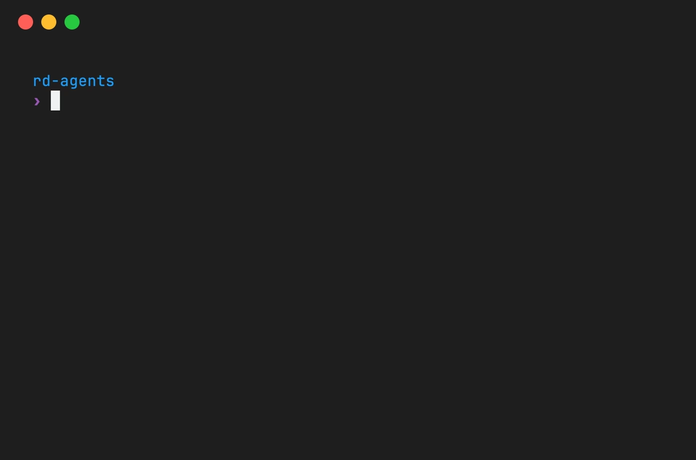

<div align="center">

<p align="center"></p>

<p align="center">
  <a href="https://docs.python.org/3/library/tomllib.html">
    <picture>
      <source media="(prefers-color-scheme: dark)" srcset="https://shieldcn.dev/badge/Python-3.11%2B-ffffff.svg?variant=outline&amp;mode=dark&amp;color=ffffff&amp;logo=python&amp;logoColor=ffda00&amp;labelTextColor=ffffff&amp;valueColor=ffda00">
      
    </picture>
  </a>
  <a href="#functionality">
    <picture>
      <source media="(prefers-color-scheme: dark)" srcset="https://shieldcn.dev/badge/Read%20by-11%20agents-ffffff.svg?variant=outline&amp;mode=dark&amp;color=ffffff&amp;logo=lu%3ABot&amp;logoColor=ffda00&amp;labelTextColor=ffffff&amp;valueColor=ffda00">
      
    </picture>
  </a>
  <a href="#license">
    <picture>
      <source media="(prefers-color-scheme: dark)" srcset="https://shieldcn.dev/badge/License-GPL%203-ffffff.svg?variant=outline&amp;mode=dark&amp;color=ffffff&amp;logo=lu%3AScale&amp;logoColor=ffda00&amp;labelTextColor=ffffff&amp;valueColor=ffda00">
      
    </picture>
  </a>
  <a href="https://github.com/deathrashed/agents/commits/main">
    <picture>
      <source media="(prefers-color-scheme: dark)" srcset="https://shieldcn.dev/github/last-commit/deathrashed/agents.svg?variant=outline&amp;mode=dark&amp;color=ffffff&amp;logoColor=ffda00&amp;labelTextColor=ffffff&amp;valueColor=ffda00">
      
    </picture>
  </a>
</p>
<p align="center">
  <a href="#plugins">
    <picture>
      <source media="(prefers-color-scheme: dark)" srcset="https://shieldcn.dev/badge/Skills-37-ffffff.svg?variant=outline&amp;mode=dark&amp;color=ffffff&amp;logo=lu%3AZap&amp;logoColor=ffda00&amp;labelTextColor=ffffff&amp;valueColor=ffda00">
      
    </picture>
  </a>
  <a href="#plugins">
    <picture>
      <source media="(prefers-color-scheme: dark)" srcset="https://shieldcn.dev/badge/Plugins-12-ffffff.svg?variant=outline&amp;mode=dark&amp;color=ffffff&amp;logo=ri%3ABsPlugin&amp;logoColor=ffda00&amp;labelTextColor=ffffff&amp;valueColor=ffda00">
      
    </picture>
  </a>
  <a href="#health-check">
    <picture>
      <source media="(prefers-color-scheme: dark)" srcset="https://shieldcn.dev/badge/Scripts-2-ffffff.svg?variant=outline&amp;mode=dark&amp;color=ffffff&amp;logo=ri%3ATbScript&amp;logoColor=ffda00&amp;labelTextColor=ffffff&amp;valueColor=ffda00">
      
    </picture>
  </a>
  <a href="#rules">
    <picture>
      <source media="(prefers-color-scheme: dark)" srcset="https://shieldcn.dev/badge/Rules-9-ffffff.svg?variant=outline&amp;mode=dark&amp;color=ffffff&amp;logo=lu%3AListCollapse&amp;logoColor=ffda00&amp;labelTextColor=ffffff&amp;valueColor=ffda00">
      
    </picture>
  </a>
  <a href="#plugins">
    <picture>
      <source media="(prefers-color-scheme: dark)" srcset="https://shieldcn.dev/badge/Marketplaces-16-ffffff.svg?variant=outline&amp;mode=dark&amp;color=ffffff&amp;logo=ri%3ATbShoppingBagCheck&amp;logoColor=ffda00&amp;labelTextColor=ffffff&amp;valueColor=ffda00">
      
    </picture>
  </a>
  <a href="#functionality">
    <picture>
      <source media="(prefers-color-scheme: dark)" srcset="https://shieldcn.dev/badge/Agents-11-ffffff.svg?variant=outline&amp;mode=dark&amp;color=ffffff&amp;logo=ri%3ABsRobot&amp;logoColor=ffda00&amp;labelTextColor=ffffff&amp;valueColor=ffda00">
      
    </picture>
  </a>
</p>
<p align="center"><strong>One set of rules, topic files and plugin lists that every AI coding agent on my two machines reads.</strong></p>

<p align="center">
  <a href="#quick-start">Quick Start</a> | <a href="#overview">Overview</a> | <a href="#functionality">Functionality</a> | <a href="#rules">Rules</a> | <a href="#plugins">Plugins</a> | <a href="#machines">Machines</a> | <a href="#health-check">Health Check</a> | <a href="#structure">Structure</a> | <a href="#license">License</a>
</p>
</div>

##  Quick Start

Requirements: `git` and a `python3` with `tomllib` (3.11 or newer). The check script looks for one on its own.

```bash
git clone https://github.com/deathrashed/agents rd-agents
cd rd-agents
scripts/agents-check
```

<p align="center"></p>

That recording is a real run on m3, trimmed to the summary lines. It reports real problems (broken symlinks, files with conflict markers), which is what the check is for. The script only reads; it never changes anything.

> [!NOTE]
> The system `python3` on macOS is 3.9, which has no `tomllib`. `scripts/agents-check` tries `python3.14` down to `python3.11`, then Homebrew's `python3`, and exits with code 2 if none works.

##  Overview

The usual setup is one instruction file per tool (`~/.claude/CLAUDE.md`, `~/.codex/AGENTS.md` and so on) that slowly drift apart. Here a single `AGENTS.md` sends every agent to `main.md` and the topic files in `rules/`, and the repo is linked into `~/.agents`. `scripts/agents-check` reports when a tool stops reading them (`instruction_pointers`) or a live file differs from the repo (`repo_drift`).

This repo replaces the earlier `deathrashed/agents`, now `deathrashed/agents-archive`, and holds only my own writing. Third-party skills installed with `npx skills` (lockfile `~/.local/state/skills/.skill-lock.json`) stay out of git. The one exception is the `obsidian` plugin in `marketplace/`, covered under [Plugins](#plugins).

##  Functionality

<p align="center"></p>

`~/.agents/AGENTS.md` holds one line: read `~/.agents/main.md` in full. `main.md` has the always-on rules and a list of topic files, each read only when it applies. Eleven agents are tracked in `checks/agents.toml`: Claude Code, Codex CLI, Cursor, Grok CLI, Grok Bot, oh-my-pi, pi, opencode, Kilo, Antigravity and Gemini CLI.

Plugins cannot be linked like files. Each agent installs them through its own CLI, so the repo keeps the plugin list and one marketplace folder (see [Plugins](#plugins)).

##  Rules

`main.md` carries ten always-on rules. The topic files in `rules/` are read when the task calls for them:

| File | Read when |
| --- | --- |
| `safety-and-changes.md` | Before any delete, move, cleanup, `sudo`, config edit outside a repo, or anything touching credentials |
| `filesystem-layout.md` | Before creating, moving or naming anything in `~`, or touching dotfiles, XDG paths or `~/.agents` |
| `working-and-reporting.md` | At the start of a multi-step task, and before writing the final report |
| `coding-style.md` | When writing or changing code, tests, generators or project docs |
| `tools.md` | When choosing CLI tools, searching, using skills, CodeGraph or memory, or delegating to subagents |
| `scripts-and-notes.md` | When writing personal scripts or their Obsidian docs |
| `homelab.md` | Before networking, SSH, mounts, Docker or anything spanning both machines |
| `conflicts.md` | When two sources disagree; open items wait for me |
| `sources.md` | To check where a rule came from |

`rules/claude-mem-context.md` is written by the claude-mem tool, so it is kept out of git on purpose.

> [!TIP]
> Paths in the rules are written as `~/...` and tagged with the machine (`cachy` or `m3`) where the two differ. Don't hardcode `/home/rd` or `/Users/...`.

##  Plugins

| Path | What it is |
| --- | --- |
| `plugins.toml` | The declared setup: 16 marketplaces and the 12 Claude plugins enabled on m3 |
| `marketplace/.claude-plugin/marketplace.json` | Claude index of the `rd` marketplace |
| `marketplace/.agents/plugins/marketplace.json` | Codex index of the same folder |
| `marketplace/plugins/obsidian/` | 37 Obsidian vault skills, with a Claude and a Codex manifest |

One folder serves both agents. Register it once per agent, then install by name:

```bash
claude plugin marketplace add ~/Projects/rd-agents/marketplace
codex plugin marketplace add ~/Projects/rd-agents/marketplace

claude plugin install obsidian@rd
codex plugin add obsidian@rd
```

The marketplace is registered with both agents on m3. The `obsidian` plugin is not installed or enabled anywhere yet, because the loose `obsidian-*` skills in `~/.agents/skills` would then load twice.

<details>
<summary> <strong>Add a Plugin</strong></summary>

Every plugin keeps one set of skills and a manifest for each agent:

```text
marketplace/plugins/<name>/
├── .claude-plugin/plugin.json
├── .codex-plugin/plugin.json     # "skills": "./skills/"
└── skills/<skill>/SKILL.md
```

Add the plugin to both marketplace files. The `name` in each entry must match the `name` in the plugin's own manifest, and paths are written from the `marketplace/` folder (`./plugins/<name>`). Validate the Claude side with `claude plugin validate marketplace/`. A plugin that already lives in its own GitHub repo is listed in the Claude file as a `github` source instead of being copied here.

</details>

##  Machines

| Machine | OS | Manifest | State on 2026-11-22 |
| --- | --- | --- | --- |
| `m3` | macOS, MacBook Air M3 | `machines/m3/manifest.toml` | `AGENTS.md`, `main.md`, `manifest.toml` and all nine rule files are symlinks into this repo; `agents-check` compares 12 and finds no difference |
| `cachy` | CachyOS Linux | `machines/cachy/manifest.toml` | The same files exist. `AGENTS.md` is identical; `main.md`, five of the nine rules and `manifest.toml` differ from this repo |

<details>
<summary> <strong>Link Layout on m3</strong></summary>

```text
~/.agents/AGENTS.md        -> ../projects/rd-agents/AGENTS.md
~/.agents/main.md          -> ../projects/rd-agents/main.md
~/.agents/manifest.toml    -> ../projects/rd-agents/machines/m3/manifest.toml
~/.agents/rules/<name>.md  -> ../../projects/rd-agents/rules/<name>.md
```

`skills/` and `plugins/` are real directories, and `repos` links to an external volume. The links are written with `projects` in lower case. The folder on m3 is `~/Projects`, and macOS ignores the difference in case; on cachy the folder is `~/projects`.

History: on 2026-11-15 m3 was linked file by file, and on 2026-11-16 `~/.agents` was rebuilt fresh with the old tree moved to `~/Archive/agents-archive`. Each machine links these files into `~/.agents` and leaves skills and tool state alone. The change log on cachy (`~/.local/state/system-cleanup/log.md`) records what was applied there.

</details>

##  Health Check

`scripts/agents-check` is a read-only check of `~/.agents` and every agent that reads it. Tool paths live in `checks/agents.toml`. It needs Python 3.11 or newer (or the `tomli` package), and runs on Linux and macOS.

| Flag or code | Meaning |
| --- | --- |
| `--json` | Print the result as JSON |
| `--config=PATH` | Use another tool map instead of `checks/agents.toml` |
| `NO_COLOR=1` | Turn status colours off. On a terminal the `[OK]`, `[WARN]` and `[FAIL]` tags are green, orange and red |
| `FORCE_COLOR=1` | Keep the colours when the output is piped, as in the recording |
| exit `0` | No FAIL |
| exit `1` | At least one FAIL |
| exit `2` | The check could not run |

> [!TIP]
> For the weekly routine, run `scripts/agents-check --json` from the repo. If you have [just](https://just.systems) installed, `just agents-check` runs the same script.

<details>
<summary> <strong>All Checks</strong></summary>

| Check | Looks for |
| --- | --- |
| `broken_links` | Broken symlinks in the `~/.agents` tree and in every tool's skills directory |
| `conflict_markers` | Git conflict markers in text files under `~/.agents` |
| `duplicate_skills` | The same skill name from two sources in one agent's directories |
| `unknown_writers` | Entries in `~/.agents/skills` outside the `npx skills` lock and this repo |
| `instruction_pointers` | Instruction files that point at `~/.agents/AGENTS.md` (compared by hash) |
| `output_hooks` | More than one output-rewriting hook per agent (rtk, context-mode, caveman) |
| `stale_plugins` | Enabled plugins that point to nothing |
| `manifest_drift` | Installed versions against the pins in `~/.agents/manifest.toml` |
| `repo_drift` | Live `~/.agents` files against this repo |
| `telemetry` | Telemetry still on for rtk or caveman |
| `token_tools` | ponytail and headroom wiring, telemetry, and one reply style per agent |

</details>

##  Structure

```text
rd-agents/
├── AGENTS.md              # one line: read ~/.agents/main.md
├── main.md                # always-on rules and the topic-file index
├── rules/                 # nine topic files, read when relevant
├── machines/
│   ├── cachy/manifest.toml    # third-party agent tools on cachy
│   └── m3/manifest.toml       # third-party agent tools on m3
├── checks/agents.toml     # where each agent reads instructions, skills, MCP, hooks
├── scripts/               # agents-check and agents_check.py
├── justfile               # just agents-check
├── marketplace/           # the rd plugin marketplace (Claude and Codex)
├── plugins.toml           # marketplaces and plugins in use
├── assets/                # demo.tape, demo.webp, flow.svg, build-media.sh
├── LICENSE
└── README.md
```

Rebuild the recording and the diagram check with `bash assets/build-media.sh`.

##  Troubleshooting

<details>
<summary> <strong>No Python Found</strong></summary>

`agents-check: no python3 with tomllib/tomli found` means no Python 3.11 or newer is on the path. On macOS run `brew install python`.

</details>

<details>
<summary> <strong>just Not Found</strong></summary>

`just` is not installed on m3. Run `scripts/agents-check` directly, or install it with `brew install just`.

</details>

<details>
<summary> <strong>Broken Pipe Traceback</strong></summary>

Piping the output into `head` prints a `BrokenPipeError` traceback, because the script does not handle a closed pipe. Pipe into `sed -n '1,14p'` or write to a file instead. The recording above does this.

</details>

<details>
<summary> <strong>Codex Plugin List Fails</strong></summary>

`codex plugin list` stops with "marketplace root does not contain a supported manifest" when any configured marketplace has no manifest. On m3 that was `claude-cowork`. Remove the offender with `codex plugin marketplace remove <name>`.

</details>

<a name="license"></a>

## <a href="https://www.gnu.org/licenses/gpl-3.0.html"></a> License

The skills under `marketplace/plugins/obsidian/` come from Vaultelligence, my fork of [obsidian-second-brain](https://github.com/eugeniughelbur/obsidian-second-brain), which is MIT licensed. Everything else here is my own work.

<div align="center">

[**𝗚𝗡𝗨 𝗚𝗣𝗟 𝗟𝗜𝗖𝗘𝗡𝗦𝗘**](LICENSE)

<a href="LICENSE"></a>

**𝗖𝗢𝗣𝗬𝗥𝗜𝗚𝗛𝗧 © 𝟮𝟬𝟮𝟲 𝗗𝗘𝗔𝗧𝗛𝗥𝗔𝗦𝗛𝗘𝗗**

e</div>

<p align="center">
  <a href="#machines">
    <picture>
      <source media="(prefers-color-scheme: dark)" srcset="https://shieldcn.dev/badge/CachyOS-%E2%9C%93-ffffff.svg?variant=outline&amp;mode=dark&amp;color=ffffff&amp;logo=cachyos&amp;logoColor=ffda00&amp;labelTextColor=ffffff&amp;valueColor=ffda00">
      
    </picture>
  </a>
  <a href="#machines">
    <picture>
      <source media="(prefers-color-scheme: dark)" srcset="https://shieldcn.dev/badge/macOS-%E2%9C%93-ffffff.svg?variant=outline&amp;mode=dark&amp;color=ffffff&amp;logo=apple&amp;logoColor=ffda00&amp;labelTextColor=ffffff&amp;valueColor=ffda00">
      
    </picture>
  </a>
</p>

<p align="center"><strong>Status:</strong> actively maintained personal config, in daily use. m3 is linked to this repo; cachy has the same files but they have drifted (see <a href="#machines">Machines</a>).</p>
