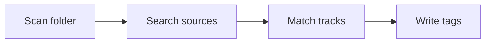

# Section Menu

Every README uses the required structure in SKILL.md. Fill its core sections
from this menu with what the project genuinely has, ordered for the reader's
first visit: what it is → how to start → what it can do → how to
shape it → how it's built. Every heading gets an icon from one Iconify set.

Headings below are suggestions; rename to fit the project ("Configure" vs
"Configuration", "Sources" vs "Providers").

## Near the top

| Section | Use when | Shape |
| --- | --- | --- |
| **Quick Start** | Always | 3–6 line code block: clone/install → first useful result. One sentence of requirements above it |
| **Install** | Several install paths (brew, release binary, store, source) | Table of method / command, or `<details>` per platform |
| **Why** / **Overview** | The name doesn't explain the purpose | 2–4 sentences, no marketing |
| **TL;DR** | The tool solves a specific pain point | **The problem** (1–2 sentences) · **The solution** (1–2 sentences) · "Why use it?" table of feature → concrete benefit. Goes above Quick Start |
| **Contents** | README > ~250 lines or > 8 sections | Compact list or two-column table |

## Show what it does

| Section | Use when | Shape |
| --- | --- | --- |
| **Features** | Distinct capabilities worth listing | Feature-cards table (icon · name · one line), or a bulleted list of bold-led lines |
| **Screenshots** / **Demo** | UI, TUI, or visual output exists | 2-column `<table>` grid with captions; GIF for flows |
| **Usage** | CLI or library | Short examples, each with one line saying what happens |
| **Commands** / **Flags** | CLI with many commands | Table: command · what it does · example |
| **How it works** | Non-obvious pipeline or architecture | Mermaid `flowchart LR` or ASCII flow, then 3–5 lines |
| **Sources** / **Integrations** / **Providers** | Talks to external services | Table with service icons (`selfhst`, `simple-icons`) |
| **Comparison** | Users will ask "why not X?" | Matrix of this vs alternatives (text marks: Yes / Partial / No, not emoji), then **When to use it** and **When something else fits better** lists |
| **Design philosophy** | The tool makes deliberate trade-offs | 3–5 principles, each a bold name and one sentence |
| **Compatibility** | Platforms/versions matter | Matrix: platform · version · status |

## Shape and extend it

| Section | Use when | Shape |
| --- | --- | --- |
| **Configuration** | Config file or env vars | Table: key · default · meaning; full commented example in `<details>` |
| **Environment variables** | Runtime reads env vars | Two tables, **Required** and **Optional**: variable · example · meaning |
| **Scripts** / **Tasks** | `package.json` scripts, `make`/`just` targets | Table: command · what it does |
| **Plugins** / **Extending** | Extension points exist | Short guide + link to docs |
| **Keyboard** / **Controls** | TUI or app shortcuts | Two-column key table |
| **Troubleshooting** | Known errors | One `<details>` per error, summary = the exact error text the user sees, body = cause and fix. Top 5 errors |
| **FAQ** | Recurring questions | One `<details>` per question, phrased as the user would ask it |
| **Limitations** | Honest constraints | Two short lists: **Doesn't do (yet)** and **Known limitations** |

## How it's built

| Section | Use when | Shape |
| --- | --- | --- |
| **Structure** | Contributors need a map | ASCII tree in a ```` ```text ```` block with `#` comments |
| **Development** / **Building** / **Tests** | Contributors build from source | Commands block; test command |
| **Roadmap** / **Status** | Work in progress | Table: item · status |
| **Changelog** | Releases exist | Link to `CHANGELOG.md`, maybe latest 3 entries |
| **Architecture** / **Data flow** | Several moving parts | ASCII or Mermaid diagram of the flow, then a key-components table: component · responsibility · file |
| **For agents** | Tool is useful to coding agents | `<details>` with an AGENTS.md blurb: one-line purpose, core commands, output format, gotchas |
| **Credits** | Uses others' work, icons, data | List with links |
| **License** | Always | Tailored block from `references/licenses.md` |

## Snippets

### Feature cards

```markdown
| | Feature | |
| --- | --- | --- |
|  | **Fast** | Scans 10k files in seconds |
|  | **Pluggable** | Add sources without rebuilding |
```

### Screenshot grid

```html
<table>
  <tr>
    <td width="50%" align="center"><br><sub><b>Main window</b></sub></td>
    <td width="50%" align="center"><br><sub><b>Settings</b></sub></td>
  </tr>
</table>
```

### Flow diagram

````markdown

````

### FAQ card

```html
<details>
<summary><b>Why does the upload say "already exists"?</b></summary>

gupload compares blob SHAs and skips identical files. Use `--force` to replace.

</details>
```

### Compatibility matrix

```markdown
| Platform | Version | Status |
| --- | --- | --- |
| macOS | 14+ | Supported |
| Linux | glibc 2.31+ | Supported |
| Windows | — | Not planned |
```

### TL;DR

```markdown
##  TL;DR

**The problem:** sharing a screenshot in an issue means uploading it, finding the URL, and hand-writing Markdown.

**The solution:** `gupload shot.png` uploads it to your asset repo and copies Markdown, HTML, or a raw link.

| Why use it | What you get |
| --- | --- |
| **One command** | Upload, route to the right folder, and copy the link |
| **Plan first** | Every upload is previewed offline before anything is published |
```

### Troubleshooting card

```html
<details>
<summary><b><code>Error: config not found at ~/.config/tool/config.json</code></b></summary>

The first run hasn't created a config yet. Run `tool init`, or copy
`src/data/config.example.json` there and fill in `owner` and `repo`.

</details>
```

### Comparison

```markdown
| | this tool | Alternative A | Manual |
| --- | --- | --- | --- |
| Setup | One command | Account + app | None |
| Offline preview | Yes | No | Yes |

**When to use it:** you upload often and want consistent paths.
**When something else fits better:** one-off uploads; drag the file into the GitHub editor.
```

### Agent blurb

````html
<details>
<summary><b>Using this from coding agents</b></summary>

```markdown
## tool: upload files to GitHub and print links
- `tool FILE --preview --json`: plan without publishing (safe to run)
- `tool FILE --execute`: publish; prints the raw URL
- Exit status 1 on any failed item; JSON output on stdout
```

</details>
````

## Ordering by project type

The required structure (top block → Quick Start → core sections → dropdowns and
hints → Structure → Development → License) always applies. These are the core
sections in the middle:

- **CLI tool**: Usage → Commands (all flags in a dropdown) → Configuration (full example in a dropdown) → Troubleshooting dropdowns
- **App / plugin**: Features → Screenshots → Configure → Compatibility → FAQ dropdowns
- **Library**: Usage → API overview table → Examples (longer ones in dropdowns)
- **Collection / scripts repo**: Contents → catalogue by category, one dropdown per category → Naming and placement rules
- **Pipeline / automation**: How it works diagram → Integrations → Configuration → Logs and outputs
- **Config / dotfiles**: What's here (table) → Why it's set up this way → How to extend → Gotchas (alerts) → Last reviewed date
- **Tool that sells itself**: TL;DR → Quick Start → Usage → Comparison → Design philosophy → Troubleshooting dropdowns → Limitations
